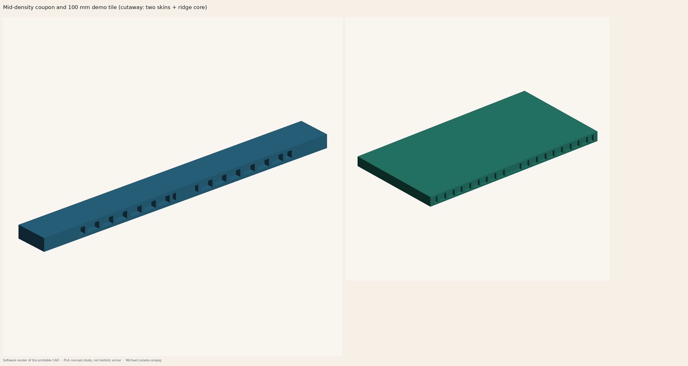
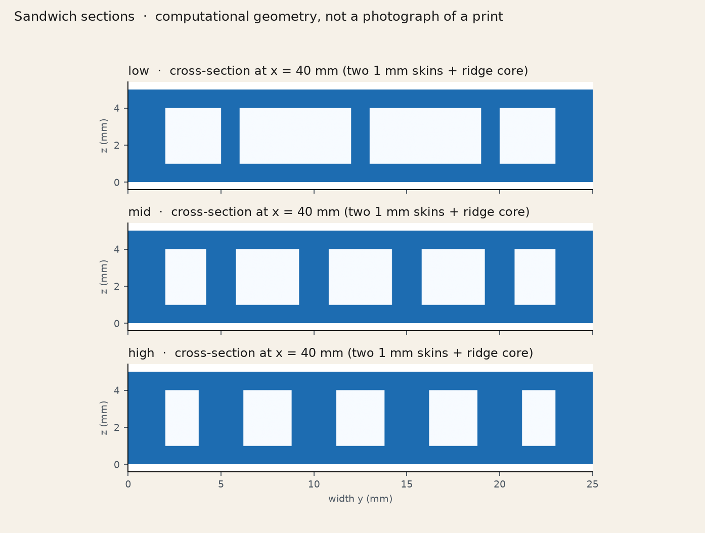

# Morpho-inspired lattice panels

**A scaled PLA concept study — not ballistic armor, and not physical test data.**

Parametric CAD, STLs, and a computational stiffness-to-weight comparison of butterfly-scale-inspired sandwich panels. I built this as an HPU Biomedical Engineering sophomore in a Biomaterials course, after a site visit at Oceanit where I saw their butterfly-wing-inspired lightweight armor work. I am not affiliated with Oceanit; this is my own classroom / portfolio study of the architecture.



The printable parts are a **two-skin sandwich** (lower + upper lamina) with a **ridge / cross-rib core**, plus solid end pads and a midspan load land for a 3-point-bend test. Three relative densities share the same 120 × 25 × 5 mm envelope as a solid control plate. A 100 × 100 × 5 mm mid-density demo tile is included for photos. Everything is meant to print **flat on a Bambu Lab X1 Carbon Cool Plate, in PLA, with no supports** (the upper skin is a short 3–8 mm bridge).



## Biology → design (honest mapping)

Published Morpho-type (and many papilionid) scales have a lower lamina, an upper lamina of longitudinal ridges joined by cross-ribs, and trabeculae connecting the two (Ghiradella 1998; Giraldo & Stavenga 2016; Ding, Xu & Wang 2009; Davis et al. 2020). *Morpho peleides* ridge pitch is about 1.7–1.8 µm; these coupons use a 5–7 mm pitch (a few-thousand-fold scale-up).

| Biological feature | What is in the CAD |
|---|---|
| Lower lamina | 1.0 mm basal skin (prints on the plate) |
| Upper lamina | 1.0 mm top skin (bridged across the windows) |
| Ridges + cross-ribs | Full-height vertical ribs, 1.0–2.4 mm thick |
| Trabeculae | Abstracted as those vertical walls between the skins |
| Ridge lamellae (“Christmas-tree” shelves) | **Not printed** — they are optical, ~10¹–10² nm, and would be unsupported overhangs if scaled up literally |

Sources and a longer caveat list: [`docs/biology_sources.md`](docs/biology_sources.md). A side-by-side schematic is in `figures/fig_schematic.png`.

## Computational comparison (estimates only)

Assumed isotropic PLA, used as *inputs* for every variant, not measured on a print: **E = 2.7 GPa**, ν = 0.33, density = 1.24 g/cm³, first-crack flexural stress = 60 MPa. As-printed PLA is anisotropic; interlayer bonding can be weaker than this in-plane modulus.

Primary model: Timoshenko beam theory with the actual sandwich I(x) along a **100 mm** 3-point-bend span. Check: linear-elastic voxel FEA (0.5 mm 8-node hexes, midspan symmetry). The two methods agree to about 2%. Gibson–Ashby open-cell (ρ*)² scaling is plotted as a comparison only; these panels sit above that curve because they are a sandwich with continuous ridges, not a foam.

| Variant | Mass (g) | ρ*/ρs (envelope) | ρ*/ρs (lattice region) | k Timoshenko (N/mm) | k FEA (N/mm) | E_eff / E_s | P first-crack est. (N) | k / mass (N/mm/g) | specific k vs solid |
|---|---:|---:|---:|---:|---:|---:|---:|---:|---:|
| solid | 18.60 | 1.000 | 1.000 | 33.48 | 33.87 | 1.000 | 250.1 | 1.80 | 1.00 |
| lattice low | 13.78 | 0.741 | 0.621 | 29.63 | 29.23 | 0.887 | 229.6 | 2.15 | 1.19 |
| lattice mid | 15.21 | 0.818 | 0.733 | 30.83 | 30.78 | 0.922 | 237.6 | 2.03 | 1.13 |
| lattice high | 16.48 | 0.886 | 0.833 | 31.81 | 31.23 | 0.951 | 245.1 | 1.93 | 1.07 |

Under those assumptions, the **low-density coupon is lightest (~74% of the solid mass) and has the highest estimated specific flexural stiffness (~1.19× the solid plate)** and specific first-crack load (~1.24×). That is a sandwich-theory result, not a lab measurement and not an armor rating.

Full tables, JSON, and the Gibson–Ashby comparison: [`results/comparison.md`](results/comparison.md), [`results/comparison.csv`](results/comparison.csv), [`results/comparison.json`](results/comparison.json). Plots: `figures/fig_stiffness.png`, `fig_specific_stiffness.png`, `fig_scaling.png`.

## Print and test it yourself

- STLs: [`stl/`](stl/) — `coupon_solid.stl`, `coupon_lattice_{low,mid,high}.stl`, `panel_demo_mid.stl`
- Print notes (X1C + Cool Plate, PLA, no supports): [`print/bambu_x1c_coolplate.md`](print/bambu_x1c_coolplate.md)
- Suggested plate layout: `figures/fig_print_layout.png`
- Test protocol (3-point bend + optional low-energy blunt drop) and honest limits: [`docs/test_protocol.md`](docs/test_protocol.md)
- One-page worksheet: `figures/fig_test_worksheet.png` and `figures/test_worksheet.pdf`

## Reproduce the analysis

```bash
python3 -m venv .venv
source .venv/bin/activate
pip install -r requirements.txt
python3 src/run_all.py
```

Or run the steps separately: `python3 src/generate_lattice.py`, `python3 src/analyze.py`, `python3 src/fea_bend.py`, `python3 src/plot_figures.py`.

Geometry is a solid envelope minus the window cavities (trimesh + manifold). Do not run a generic “fix normals” repair on the STLs — that can flip the inward cavity shells and fill the cells.

## Limitations

- No physical tests have been run in this repository. Weigh the prints and fill out the worksheet before claiming an experimental result.
- Assumed isotropic PLA ignores print orientation, interlayer strength, and viscoelasticity.
- The voxel FEA is a coarse linear-elastic check (one voxel size, no contact pads, no plasticity).
- Closed cells must be *bridged*, not supported; inspect the top skin after printing.
- A PLA coupon is not armor, not chitin, and not an Oceanit prototype.

## License

MIT. See [`LICENSE`](LICENSE).

Author: Michael Lozada-Longog, Hawaii Pacific University, Biomedical Engineering.
